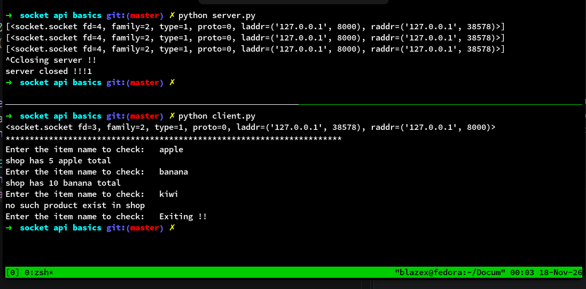

## required knowledge 
- During send / receive data always remember : 
    - str is text (Unicode), while bytes is raw 0-255 values. The network only carries bytes.
    - Encode before sending and decode after receiving.
    - TCP connect flow: SYN, then SYN-ACK if a listener exists, or RST if not.
    - Socket states: a server must go bind, then listen, then accept before a client can connect.
    - Start the server first, then the client.
- one port can have more than one socket (but 2 socket can't bind() at same port ).
- one socket can't use multiple ports

### Output

